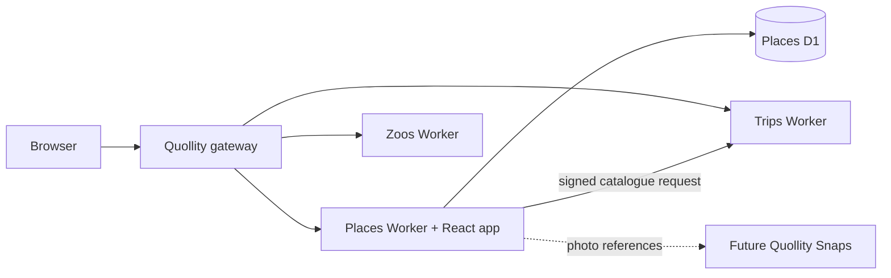

# Places architecture

## Application boundaries

Places is a private Quollity child Worker. It owns place identity, visit history, visit scores, attendees, personal notes, ranked collections, and references to Snaps. Trips owns trip identities and itinerary days. Zoos retains its specialist data and interfaces. Snaps will own photos and media delivery.

The React client calls `/places/api/...` in production and `/api/...` locally. The gateway strips `/places` before forwarding to the child. Vite supplies the production asset base, React Router supplies the corresponding basename, and the generated Worker configuration serves client assets.

## Modules

| Path                   | Responsibility                                                        |
| ---------------------- | --------------------------------------------------------------------- |
| `shared/contracts.ts`  | Zod request/response contracts, domain types, date/rating validation. |
| `shared/rankings.ts`   | Manual-board eligibility and automatic ranking semantics.             |
| `shared/paths.ts`      | Cross-component canonical links.                                      |
| `worker/index.ts`      | API composition, access control, people and reference-data endpoints. |
| `worker/auth.ts`       | Gateway signature verification and local editor identity.             |
| `worker/http.ts`       | Bounded request parsing and API errors.                               |
| `worker/repository.ts` | Database row mapping, place summaries, visit/attendee reads.          |
| `worker/trips.ts`      | Signed Trips catalogue calls and canonical trip-ID validation.        |
| `worker/routes/`       | Places, visits, boards, and future Snaps-reference endpoints.         |
| `migrations/`          | Schema, indexes, summary view, types, and initial people.             |
| `src/`                 | Directory, detail pages, forms, rankings, people, and API client.     |
| `tests/`               | In-process API tests against the actual SQLite migrations.            |

## Ownership and identity

This is a shared personal archive. An overall rating belongs to a visit, not separately to each attendee. `created_by` records the editor who created a visit or board; all authorised viewers see the same records and editors can maintain them. Attendees can include people who do not have editor accounts.

Michael and Jack use the stable UUIDs already present in Zoos. Login aliases map trusted gateway editor identities to those people. Editing the people list changes names and active status; it does not grant gateway access or create login aliases. The local development identity resolves a stable person ID, so renaming Michael does not break development authentication.

Production requests require a gateway HMAC over timestamp, method, rewritten pathname, role, and identity. Signatures expire after 60 seconds. Viewers can read but cannot mutate. Production uses `AUTH_MODE=gateway`; local mode only accepts loopback hosts. Incoming Origin headers must match the request origin for writes. API responses are private and not cached.

## Persistence and invariants

- Place identity, description, and reusable notes are stored once.
- Visits hold dates, optional trip references, notes, ratings, and attendees.
- Ratings are integer tenths in storage, constrained to 10–50. The summary view averages only non-archived, rated visits, returning a 1–5 score. Keep the full average for ranking and round only for display.
- Unrated visits increase visit counts without affecting the average. Archived visits stay in history but do not contribute to active summaries.
- Wishlist is independent of visits and archiving.
- Archive/restore applies independently to places, visits, and boards. Archiving a place hides it from active directories and automatic ranks without cascading archive flags to its visits. Restoring it restores visibility of its previously active visits.
- There are no permanent deletion endpoints for places, visits, or boards. Deactivating a person preserves attendee history.
- An explicit board contains each place once, with unique positions. Replacing an order uses an atomic D1 batch. Type/country/region filters constrain eligibility; edits that would invalidate an active board membership are rejected until that membership is removed.
- Archived places remain visible as archived entries in existing manual boards. Remove them from a board, or restore them, before saving a revised order.
- Foreign keys require a visit-linked Snaps reference to belong to the same place. A partial unique index permits one cover reference per place.
- Places has no R2 binding, upload endpoints, or copied media. Removing a Snaps link only removes the relationship.

API writes perform domain validation before issuing SQL. The database supplies a second layer of constraints. Batches make visit/attendee writes, board reorderings, and cover-reference replacements atomic. DB and R2 cannot accidentally diverge because this component stores no media.

## Trips contract

`GET /api/trips` on the Trips Worker provides canonical `tripId`, name, country, start/end dates, and canonical URL. Places calls it through the `TRIPS` service binding using the existing Quollity HMAC contract. New or changed trip links must match this catalogue; arbitrary trip IDs are rejected. An unchanged validated link can be retained while editing if Trips is offline.

`trip_references` caches validated display metadata. It is not a separate trip registry: IDs and canonical URLs originate in Trips. Metadata is refreshed when a new/changed link is validated. A future catalogue synchronisation can refresh existing display caches when trip names change.

Places exposes `GET /api/visits?tripId=...` for Trips to display place visits beside zoo visits. Each result includes its place, visit-specific score and notes, attendee list, date, and canonical Place URL. Results are ordered by date; pagination uses `offset` and a limit of 100. Trips can group visits against realised days by local date.

The existing Trips API has no generic Places relationship or day-validation endpoint. This foundation does not invent a day ID or copy itinerary data. Adding the consumer UI and authenticated Places service binding in Trips is the next integration step. Both components should create visits through `POST /api/places/:placeId/visits`, including `tripId`, so there is one relationship to maintain.

## Snaps contract

`place_snap_links` stores an external `snapId`, optional visit association, caption, cover flag, and order. The API can maintain those references, but the UI currently presents links rather than image previews or an upload form.

`/snaps/photos/:snapId` is a **provisional** canonical-link convention, not a claim that Snaps already serves that route. Before activating the integration, confirm Snaps IDs and routes, add reference validation, and retrieve authorised thumbnail URLs through a Snaps adapter. No photo limits are imposed here because Snaps will own them.

## Bounded queries and current limits

The directory is paginated, with a default limit of 100 and maximum of 500. Automatic ranking uses a SQL window function over the filtered set before pagination, so ties remain valid across pages. Type/country/region rankings use the average across all active visits, even when directory visit filters select a subset.

Visit-based directory filters require trip, year, and attendee to match the same active visit. Counts represent distinct places, countries, and types within the filtered set. The UI directory uses pages of 60 cards. The place page currently loads up to 500 historical visits; the board picker and collection list load up to 500 records; the automatic rankings screen shows the top 100. Extend those UI limits with pagination if the archive outgrows them.

JSON requests are bounded to 128 KiB and catalogue responses to 1 MiB. Attendee reads and board-member validation use chunks of 80 bound IDs. The API has no offline mutation queue, dimension ratings, or optimistic concurrency versions yet; simultaneous edits use last-write-wins semantics. Those are future features, not hidden guarantees of this foundation.

## Verification

API integration tests execute both migrations in Node's in-memory SQLite and run the Hono app against a D1-shaped adapter. Its batch adapter uses real SQLite transactions. Tests cover repeat visits, averages, archival recovery, filters, ranking ties/order, constrained metadata, people, Snaps references, trip-ID validation, and the gateway boundary.

These tests do not replace live Cloudflare runtime or browser checks. Type checking, Vite client/Worker builds, and the production Wrangler dry run validate the packaging. A live preview and local D1 migration remain to be run in an environment that permits opening local ports.

## Visual shell and shared account

`src/design.css` owns local palette roles: museum terracotta, warm cream and
oxblood, anchored by shared Quollity green/paper. The two-row shell separates
family links/account status from Places/Rankings/People navigation. The latter
uses terracotta with cream labels and an explicit active underline. Main content
uses an 1180px frame, 32px desktop/16px phone gutters, Georgia editorial titles
and system/Inter sans controls. Existing specialised forms, lists and cards
retain their structure. Cards use restrained architectural panels, clear focus,
small hover lift and a reduced-motion override; no character artwork is invented.

Viewer/editor status comes from the existing Places session. The account link
and read-only creation boundary point to `/#account`, opening the Gateway menu.
The Gateway owns `/editor`, Cloudflare Access validation and root-scoped session
cookies. Places owns actor resolution and write authorization; there is no
second editor login or new identity datastore here. Initial reference-load
errors retain retry and provide a Gateway account recovery link.
